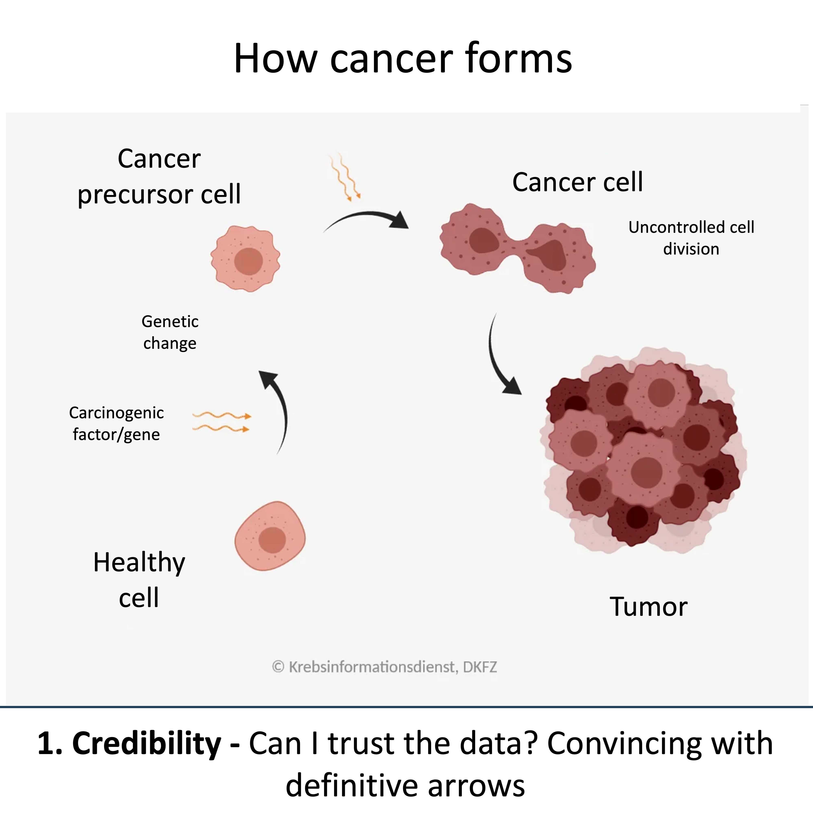

## Figures should inform, not persuade – but before information comes engagement: How we make our work relatable. 

In the [October issue of Nature Methods](https://rdcu.be/WD88cB1kFcva), we write about seven principles how to create engagement in figures. 

Every visualization involves decisions about what to show, what to emphasize, how to organize information, and how to guide the reader’s attention. These decisions influence whether a message is clear, memorable, and actionable. 

This was already done is some of the most influential scientific visualizations. Darwin’s tree of life made evolutionary relationships immediately apparent – he pointed out where humans are in the tree, and related them to the other species and to time. John Snow’s cholera map connected deaths to recognizable streets and houses – creating a proximity to familiar places in London. Ed Hawkins’ climate stripes allow people to search climate change in their hometown. These visualizations do not manipulate, but they make abstract information accessible and relevant to the readers.

What these examples share is that they use proximity principles from rhetorics. They reduce the perceived distance between data and its audience. In our new Nature Methods Point of View, we explore seven dimensions of proximity: credibility, plausibility, importance, temporal proximity, spatial proximity, individual-level focus, and anticipating consequences. Each of these principles is already widely used in biological figures today, often without the authors explicitly recognizing them. But understanding proximity allows us to use these principles more deliberately, while remaining faithful to the underlying evidence. That way we ensure that our figures are engaging, which helps their effectiveness. 

Gift links to all articles so far in the series: 
- Color Scales: the Birth of Viridis [gift link](https://rdcu.be/fnPhk)
- Click to plot [gift link](https://rdcu.be/fs1Q6) 
- Code to plot [gift link](https://rdcu.be/fyill)
- The Graphical abstracts [gift link](https://rdcu.be/LiKWakyaVNQa) 
- The companion website [link](https://www.nature.com/articles/s41592-026-03276-7)

::: {#fig-}

:::

